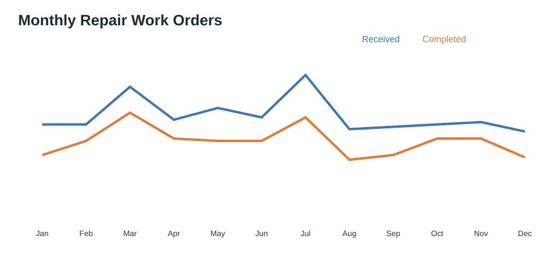
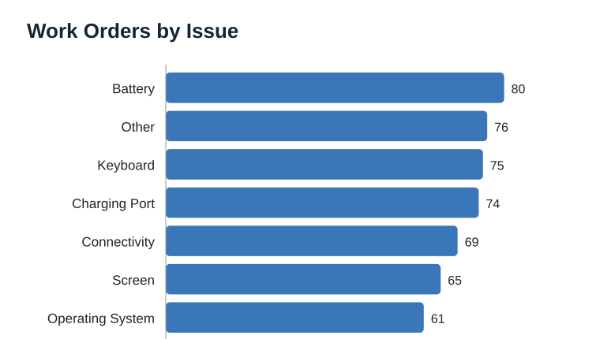
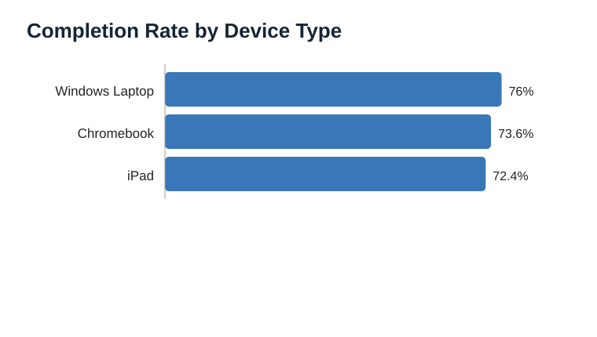

# 01 — IT Asset & Repair Operations Analytics

## Business question
How can a device-repair operation monitor intake, completion, turnaround, issue mix, and technician workload with a relational database?

**Data disclosure:** 500 reproducible synthetic work orders. These are not records from iTurity or any real employer/customer.

## Run results

| KPI | Result |
|---|---:|
| Work orders | 500 |
| Completed | 370 |
| Completion rate | 74.0% |
| Average turnaround (completed) | 6.51 days |
| Repeat-repair flag rate | 7.6% |
| Average labor | 1.87 hours/order |
| Parts cost | $14,186.00 |

The repeat-repair flag is randomly generated for this demo, not a measured quality metric.

## Visualizations







## Technical implementation
SQLite tables for customers, technicians, devices, work orders, and status history; primary/foreign keys, check constraints, indexes, analytical views, SQL joins/aggregations, Python data generation, KPI exports, and Matplotlib charts.

## Re-run locally

```bash
pip install -r ../../requirements.txt
python src/analyze_and_visualize.py
```

This rebuilds the SQLite database and regenerates CSV summaries and charts.

## Results
- [Monthly operations](outputs/monthly_operations.csv)
- [Issue performance](outputs/issue_performance.csv)
- [Technician performance](outputs/technician_performance.csv)
- [Device type performance](outputs/device_type_performance.csv)
- [Run results](outputs/RESULTS.md)

## Limitations
No warranty logic, parts inventory, SLA calendars, customer satisfaction, or seasonality. Results are workflow examples, not operational benchmarks.
