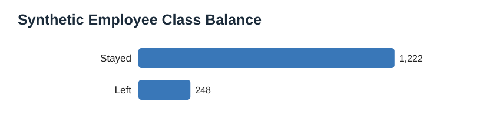
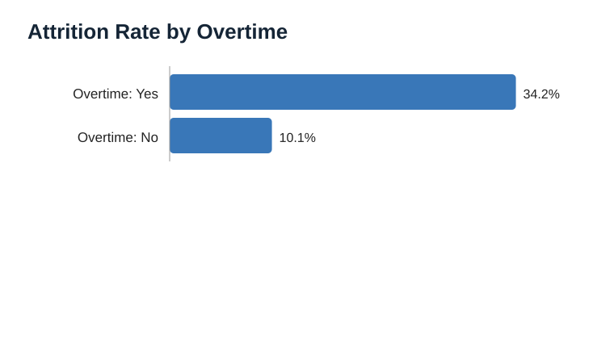
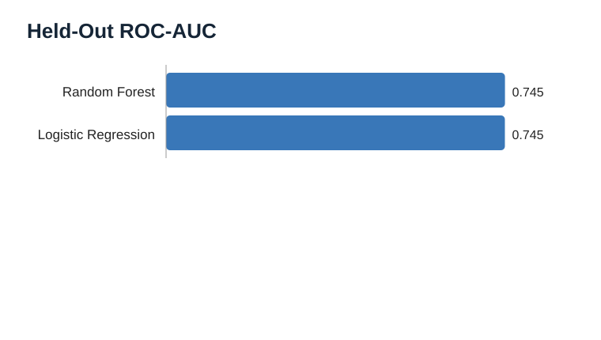
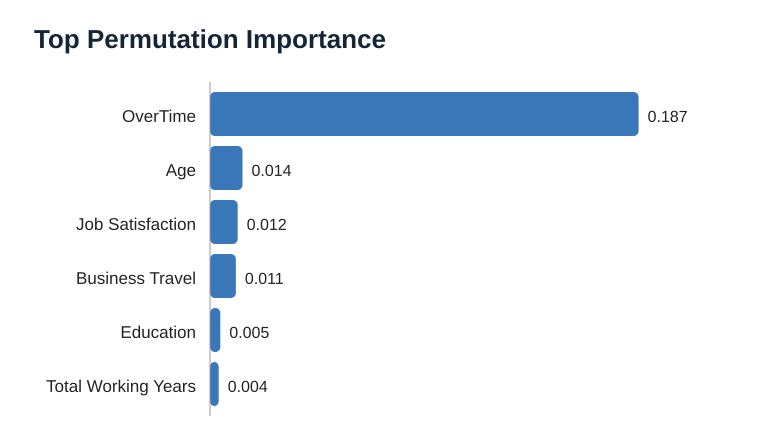

# 03 — Employee Attrition Analysis & Prediction

## Business question
What patterns are associated with attrition in a simulated workforce, and how do baseline classification models perform on held-out records?

**Data disclosure:** this executed version uses 1,470 seeded synthetic employee records created by `src/generate_synthetic_data.py`. It is not IBM's HR sample dataset and contains no real employee information.

## Run results
- Synthetic employee records: **1,470**
- Synthetic attrition rate: **16.9%**
- Overtime = Yes attrition rate: **34.2%**
- Overtime = No attrition rate: **10.1%**
- Best ROC-AUC on the stratified 25% held-out test split: **0.745 (Random Forest)**

## Model comparison

| Model | ROC-AUC | Attrition precision | Attrition recall | Attrition F1 | Accuracy |
|---|---:|---:|---:|---:|---:|
| Random Forest | 0.745 | 0.464 | 0.210 | 0.289 | 0.826 |
| Logistic Regression | 0.745 | 0.302 | 0.726 | 0.427 | 0.671 |

Logistic regression favors recall while random forest favors precision/accuracy at the default threshold. This demonstrates why accuracy alone is insufficient for imbalanced classification.

## Visualizations










## Methodology
- Seeded synthetic dataset generation with a minority attrition class.
- Stratified train/test split; preprocessing is fitted within a pipeline on training data only.
- Median imputation and standardization for numeric features; mode imputation and one-hot encoding for categorical features.
- Logistic regression and random forest compared on the same held-out test set.
- ROC-AUC, precision, recall, F1, accuracy, confusion matrices, ROC curves, and held-out permutation importance.

## Run locally

```bash
pip install -r ../../requirements.txt
python src/analyze.py
```

## Results
- [Model comparison](outputs/model_comparison.csv)
- [Class balance](outputs/class_balance.csv)
- [Overtime breakdown](outputs/attrition_by_overtime.csv)
- [Permutation importance](outputs/permutation_importance.csv)
- [Run results](outputs/RESULTS.md)

## Responsible use and limitations
This is a modeling workflow demonstration, not an HR decision tool. The synthetic target is generated from selected features, so model performance and importance reflect programmed relationships, not evidence about real workplaces. Never use attrition predictions to screen, rank, discipline, or make employment decisions about individuals. Real applications require legal review, fairness testing, transparency, consent, and human oversight.
